# PeakOff

**Connecting Smart Business Optimization with Real-Time Customer Opportunities**

**PeakOff** is a dynamic discount and customer-demand optimization platform that connects businesses in the entertainment, hospitality, food, and leisure industries with customers who want to spend their free time more efficiently while saving money.

By analyzing real-time capacity, historical traffic, and inventory lifecycles, PeakOff helps businesses fill off-peak seats and reduce perishable waste while protecting profit margins—and gives customers instant access to nearby, time-sensitive deals via single-use QR coupons.

---

## Target Audience

PeakOff operates as a two-sided marketplace serving both businesses and consumers:

### Business Owners (B2B)
- Restaurants
- Cafes and coffee shops
- Anti-cafes
- Pubs and bars
- Tea houses
- Bowling centers
- Fitness centers
- Children's entertainment centers
- Amusement and recreational venues

### Customers (B2C)
- Employees looking for somewhere to spend time after work
- University students waiting for public transportation
- People looking for affordable food, drinks, entertainment, and leisure activities
- People interested in nearby special offers and flash deals

---

## End-to-End Platform Workflow

**Title:** `PEAKOFF — END-TO-END PLATFORM WORKFLOW`  
**Subtitle:** *Connecting Smart Business Optimization with Real-Time Customer Opportunities*

### Serpentine (Snake-Shaped) Process Map

The workflow follows a continuous snake-shaped progression across three primary participants (**Business Owner**, **PeakOff Platform**, and **Customer**), with a continuous learning feedback loop returning from Stage 13 to Stage 03:

```text
ROW 1 (Left ──► Right)
┌───────────────────────────┐    ┌───────────────────────────┐    ┌───────────────────────────┐    ┌───────────────────────────┐    ┌───────────────────────────┐
│ 01. Business Registration │───►│ 02. Data Integration      │───►│ 03. Demand & Sales        │───►│ 04. Dynamic Discount      │───►│ 05. Business Approval     │
│ [Storefront]              │    │ [Database]                │    │     Analysis [Bar Chart]  │    │     Optimization [AI]     │    │     & Publication [Check] │
│ ● BUSINESS OWNER          │    │ ● BUSINESS / PLATFORM     │    │ ● PEAKOFF PLATFORM        │    │ ● PEAKOFF AI ENGINE       │    │ ● BUSINESS OWNER          │
└───────────────────────────┘    └───────────────────────────┘    └───────────────────────────┘    └───────────────────────────┘    └─────────────┬─────────────┘
                                                                                ▲                                                                 │
                                                                                │ (Continuous Feedback Loop)                                      ▼
ROW 2 (Right ◄── Left)                                                          │                                                                 │
┌───────────────────────────┐    ┌───────────────────────────┐    ┌─────────────┴─────────────┐    ┌───────────────────────────┐    ┌─────────────┴─────────────┐
│ 10. Customer Visits       │◄───│ 09. QR Coupon Generation  │◄───│ 08. Customer Selects      │◄───│ 07. Customer Discovery    │◄───│ 06. Special Offers &      │
│     Business [Map Pin]    │    │     [QR Code]             │    │     an Offer [Bag]        │    │     [Smartphone / Pin]    │    │     Inventory [Package]   │
│ ● CUSTOMER                │    │ ● PEAKOFF PLATFORM        │    │ ● CUSTOMER                │    │ ● CUSTOMER / PLATFORM     │    │ ● BUSINESS / PLATFORM     │
└─────────────┬─────────────┘    └───────────────────────────┘    └───────────────────────────┘    └───────────────────────────┘    └───────────────────────────┘
              │
              ▼
ROW 3 (Left ──► Right)
┌───────────────────────────┐    ┌───────────────────────────┐    ┌───────────────────────────┐
│ 11. QR Verification &     │───►│ 12. Transaction &         │───►│ 13. Continuous Learning   │───► (Returns to Stage 03: Demand & Sales Analysis
│     Redemption [Shield]   │    │     Feedback [Receipt]    │    │     & Optimization [ Loop]│      & Stage 04: Dynamic Discount Optimization)
│ ● BUSINESS / PLATFORM     │    │ ● BUSINESS & CUSTOMER     │    │ ● PEAKOFF AI ENGINE       │
└───────────────────────────┘    └───────────────────────────┘    └───────────────────────────┘
```

### Architecture & Flow Diagram (Mermaid)

```mermaid
flowchart LR
    subgraph Row1["Row 1: Onboarding & Smart Offer Creation (Left ➔ Right)"]
        direction LR
        S01["01. Business Registration<br/>(Business Owner)"] --> S02["02. Business Data Integration<br/>(Business / Platform)"]
        S02 --> S03["03. Demand & Sales Analysis<br/>(PeakOff Platform)"]
        S03 --> S04["04. Dynamic Discount Optimization<br/>(PeakOff AI)"]
        S04 --> S05["05. Approval & Publication<br/>(Business Owner)"]
    end

    subgraph Row2["Row 2: Inventory Specials, Discovery & Claiming (Right ➔ Left)"]
        direction RL
        S06["06. Special Offers & Inventory<br/>(Business / Platform)"] --> S07["07. Customer Discovery<br/>(Customer App)"]
        S07 --> S08["08. Customer Selects Offer<br/>(Customer)"]
        S08 --> S09["09. QR Coupon Generation<br/>(PeakOff Platform)"]
        S09 --> S10["10. Customer Visits Business<br/>(Customer)"]
    end

    subgraph Row3["Row 3: Verification, Transaction & Continuous Learning (Left ➔ Right)"]
        direction LR
        S11["11. QR Verification & Redemption<br/>(Business / Platform)"] --> S12["12. Transaction & Feedback<br/>(Business & Customer)"]
        S12 --> S13["13. Continuous Learning & Optimization<br/>(PeakOff AI)"]
    end

    S05 --> S06
    S10 --> S11
    S13 -. "Feedback Loop: Actual vs. Predicted Demand" .-> S03
    S13 -. "Refine Discount Models" .-> S04
```



---

## Detailed Workflow Stages (01–13)

### STAGE 01 — Business Registration
- **Participant:** Business Owner
- **Icon:** Storefront
- **Process:** A business owner joins PeakOff and creates a business profile.
- **Information Provided:**
  - Business name and category
  - Location and opening hours
  - Available products and services
  - Available seating capacity or entertainment capacity
  - Maximum permitted discount percentage
- **Output:** Business profile successfully created.

### STAGE 02 — Business Data Integration
- **Participant:** Business Owner / PeakOff Platform
- **Icon:** Database
- **Process:** The business provides operational and historical information to PeakOff.
- **Data Includes:**
  - Historical daily sales and previous customer traffic
  - Current customer count and available tables, seats, or capacity
  - Product inventory and expiration dates (where applicable)
  - Current revenue and discount limitations
- **Output:** Business data becomes available to the PeakOff system.

### STAGE 03 — Demand and Sales Analysis
- **Participant:** PeakOff Platform
- **Icon:** Bar Chart
- **Process:** PeakOff analyzes business performance using historical and real-time operational data.
- **Algorithm Evaluates:**
  - Sales compared with previous days
  - Customer traffic patterns, peak and off-peak hours, and expected demand
  - Available capacity
  - Inventory and approaching expiration dates
  - Historical discount performance
- **Output:** Demand forecast and current business performance assessment.

### STAGE 04 — Dynamic Discount Optimization
- **Participant:** PeakOff Platform (AI / Optimization Engine)
- **Icon:** Brain / AI / Sliders
- **Process:** PeakOff's optimization algorithm calculates an appropriate discount recommendation designed to increase customer traffic while protecting profitability.
- **Algorithm Considers:**
  - Business-defined maximum discount threshold
  - Expected customer demand and current occupancy
  - Historical sales performance, revenue, and profit margins
  - Time of day and inventory expiration risk
- **Important Business Rule:** The recommended discount is dynamic and may increase during low-demand periods, but **must never exceed the maximum discount percentage established by the business owner**.
- **Output:** Optimized discount recommendation.

### STAGE 05 — Business Approval and Offer Publication
- **Participant:** Business Owner
- **Icon:** Check Circle
- **Process:** The business owner reviews and controls the proposed offer.
- **Owner Actions:**
  - Accept the recommended discount or adjust the offer within permitted limits
  - Set the number of available coupons
  - Publish, pause, or deactivate the offer
- **Output:** An active offer becomes visible on PeakOff.

### STAGE 06 — Special Offers and Inventory Management
- **Participant:** Business Owner / PeakOff Platform
- **Icon:** Package / Clock
- **Process:** A separate but integrated mechanism handles expiration-sensitive and promotional inventory.
- **Eligible Offers:**
  - Products with a few days remaining before expiration
  - Excess inventory
  - Newly introduced or promotional products
  - Newly opened businesses seeking initial customers
- **Display:** Highlighted in a dedicated **Special Offers** section.
- **Output:** Additional promotional opportunities and reduced product waste.

### STAGE 07 — Customer Discovery
- **Participant:** Customer / PeakOff Platform
- **Icon:** Smartphone / Map Pin
- **Process:** Customers open the PeakOff mobile application to browse real-time opportunities.
- **Platform Presents:**
  - Nearby businesses, categories, and distance from the customer
  - Available discounts and Special Offers
  - Offer expiration times and available coupon quantities
  - Highlighted offers in busy urban areas to encourage visiting nearby venues instead of waiting in congested locations or transit queues
- **Output:** Relevant offers are presented to customers.

### STAGE 08 — Customer Selects an Offer
- **Participant:** Customer
- **Icon:** Shopping Bag
- **Process:** The customer explores available businesses and selects an offer of interest.
- **Customer Views:**
  - Business information, location, and distance
  - Discount percentage and eligible products or services
  - Offer validity, terms, and conditions
- **Output:** Customer selects a specific business offer.

### STAGE 09 — QR Coupon Generation
- **Participant:** PeakOff Platform
- **Icon:** QR Code
- **Process:** After selecting an offer, the customer obtains a unique digital discount coupon protected against repeated redemption.
- **QR Metadata Includes:**
  - Customer/session identifier and business identifier
  - Selected offer and discount percentage
  - Coupon validity and redemption status
- **Output:** Unique digital QR coupon generated.

### STAGE 10 — Customer Visits the Business
- **Participant:** Customer
- **Icon:** Map Pin / Store
- **Process:** The customer travels to the selected venue and presents the QR coupon to the business staff.
- **Output:** Customer arrives at the business with a valid coupon.

### STAGE 11 — QR Verification and Redemption
- **Participant:** Business Owner / PeakOff Platform
- **Icon:** Scan / Shield Check
- **Process:** The business scans the customer's QR code for instant verification.
- **PeakOff Verifies:**
  - Coupon authenticity and expiration
  - Business association and offer validity
  - Previous redemption status
- **Decision:** If valid, the system authorizes the discount; if invalid or already redeemed, the transaction is rejected.
- **Output:** Coupon successfully redeemed or rejected.

### STAGE 12 — Transaction and Feedback
- **Participant:** Business Owner & Customer
- **Icon:** Receipt / Credit Card
- **Process:** Following successful verification:
  - The business applies the discount and completes the sale
  - The transaction and customer activity are recorded
  - Coupon status changes to **Redeemed**
  - Business sales data is updated
  - Customers can optionally leave feedback or rate their experience
- **Output:** Completed transaction and updated platform data.

### STAGE 13 — Continuous Learning and Optimization
- **Participant:** PeakOff Platform (AI / Analytics Engine)
- **Icon:** Refresh / Trending Up
- **Process:** Newly collected transaction data is fed back to the PeakOff backend to continuously refine the platform.
- **System Actions:**
  - Compare actual results with predicted demand
  - Evaluate discount effectiveness and identify high-performing offers
  - Improve future demand forecasts and optimize discount recommendations
  - Help businesses make better operational decisions
- **Output:** Continuous feedback loop returning to **Stage 03 (Demand & Sales Analysis)** and **Stage 04 (Dynamic Discount Optimization)**.

---

## Core Technical & Business Rules

1. **Merchant-Controlled Ceilings:** Businesses determine their own maximum discount threshold; PeakOff's algorithm will never exceed this cap.
2. **Data-Driven Recommendations:** Dynamic discounts are calculated from real-time demand, available capacity, historical performance, profit margins, and business constraints.
3. **Full Publication Control:** Business owners retain final approval to accept, modify, pause, or cap coupon quantities on any offer.
4. **Perishable & Promotional Engine:** Special Offers act as an integrated revenue and waste-reduction channel for expiring stock, excess inventory, and new launches.
5. **Single-Use Cryptographic/Unique QR Coupons:** Every generated QR coupon is tied to a customer session, business, and offer, and can only be redeemed once.
6. **Closed-Loop Machine Learning:** Every redeemed coupon and completed transaction feeds back into the forecasting and optimization engine.

---

## Visual & Presentation Design Specification

When rendering the workflow diagram for pitch decks or investor presentations:

- **Canvas & Layout:**
  - **16:9 landscape** presentation canvas.
  - Continuous **serpentine (snake-shaped)** flow: Row 1 (Left → Right, Stages 01–05) → Curve Down → Row 2 (Right → Left, Stages 06–10) → Curve Down → Row 3 (Left → Right, Stages 11–13) → Feedback loop arrow back to Stages 03/04.
  - 4–5 rounded rectangular nodes per row with consistent spacing, generous whitespace, subtle shadows, and non-overlapping directional arrows.
- **Color Palette & Semantic Encoding:**
  - **Dark Navy (`#14213D`):** Section labels, headers, and major workflow stages
  - **Electric Blue (`#2878FF`):** Platform and backend operations
  - **Teal (`#16B8A6`):** Successful actions and customer interactions
  - **Purple:** AI and dynamic discount optimization processes
  - **Orange:** Special offers and expiration-sensitive inventory
  - **Light Background (`#F5F7FB`)**, **White (`#FFFFFF`)** node cards, and **Neutral Grey (`#8993A4`)** secondary text/connectors

---

## Running the Local Prototype Demos

This repository includes interactive web applications and a real-time sync engine for both sides of the PeakOff platform:

- **`dashboard/`** — B2B Business Owner Dashboard (`http://localhost:3000`)
- **`mobile/`** — B2C Mobile Customer Application (`http://localhost:3001`)
- **`src/engine.js` & `server.js`** — Core Dynamic Discount Optimization Engine & live cross-app sync server

### Quick Start

Run both web applications locally with live cross-app synchronization:

```bash
npm start
# or
./start-demos.sh
```

Or run each application individually:

```bash
# Start the Business Dashboard on port 3000
npm --prefix dashboard run dev

# Start the Mobile Customer App on port 3001
npm --prefix mobile run dev
```
